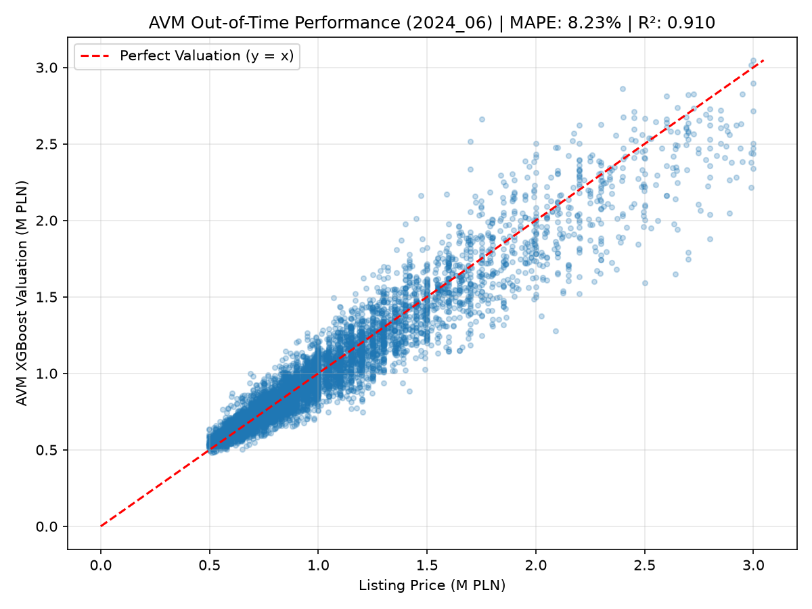
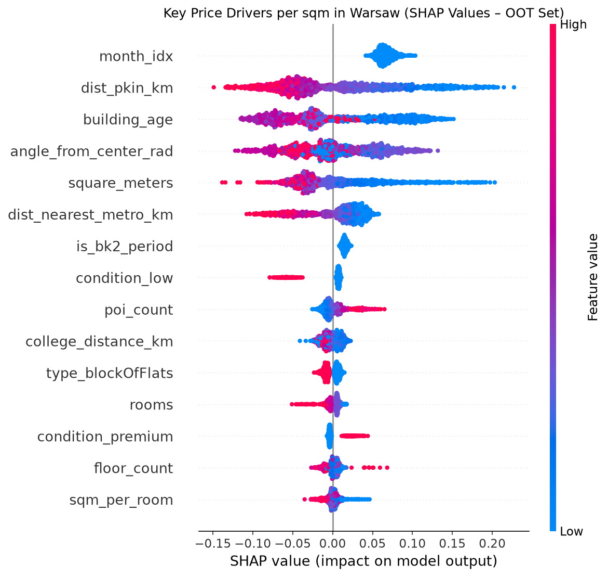
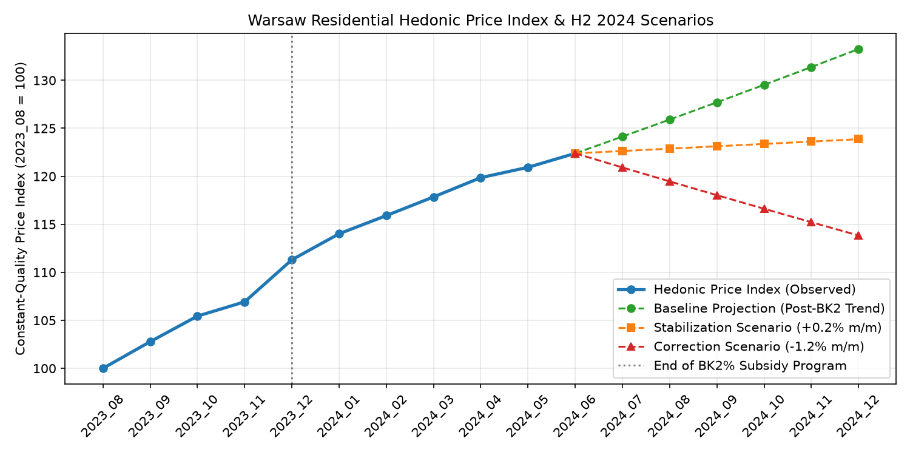
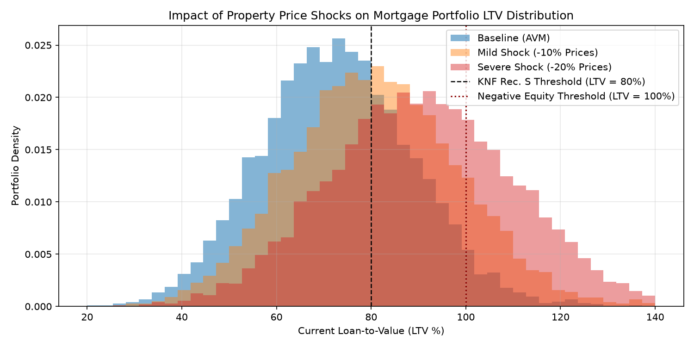
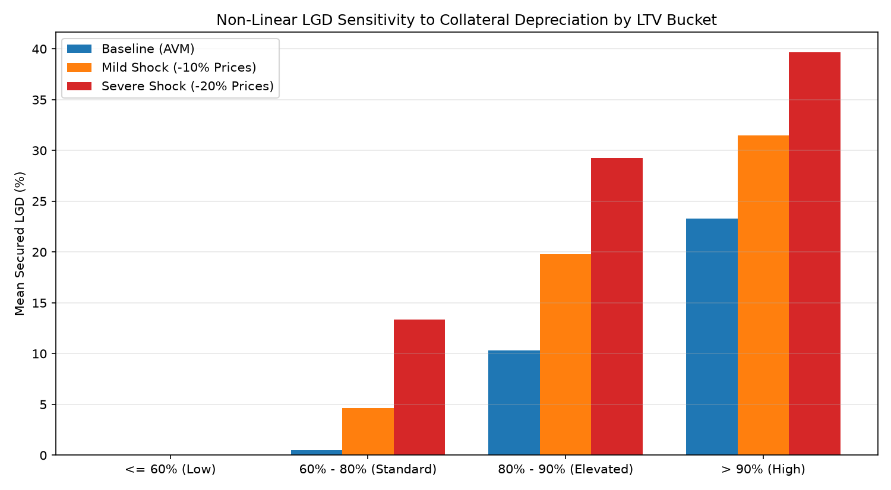

# Automated Valuation Model (AVM) & Mortgage Collateral Risk Stress-Testing

End-to-end credit risk & collateral valuation pipeline built in **Python** and **DuckDB (SQL)** for the Warsaw residential real estate market (`2023_08` – `2024_06`). The project bridges hedonic/ML property valuation with banking collateral risk management (**LTV**, forced-sale haircuts, and **secured LGD** sensitivity under housing market downturn scenarios).

## Business Context & Objectives
From a retail banking perspective (aligned with **KNF Recommendation S** and **IRB / IFRS 9** collateral frameworks), accurate property valuation is critical both at loan origination and during ongoing portfolio monitoring:
1. **Market Dynamics & Short-Term Trajectory:** Quantifying structural price drivers and isolating pure market inflation (including the *Bezpieczny Kredyt 2%* stimulus shock and subsequent cooling in H1 2024).
2. **Out-of-Time AVM Valuation:** Predicting market values without temporal data leakage.
3. **Collateral Risk & LGD Convexity:** Translating AVM valuations into portfolio **Loan-to-Value (LTV)** distributions and stress-testing **Loss Given Default (LGD)** under `-10%` and `-20%` property price shocks.

---

## Architecture & Pipeline Structure

```text
avm-collateral-risk/
├── data/
│   ├── raw/                  # 11 monthly Kaggle snapshots (apartments_pl_2023_08..2024_06.csv)
│   └── processed/            # Clean Parquet datasets & OOT predictions
├── models/                   # Serialized XGBoost AVM + preprocessing pipeline
├── reports/
│   └── figures/              # High-resolution diagnostic, SHAP & stress-test plots
├── src/
│   ├── 01_ingest.py          # DuckDB ETL, anti-leakage deduplication & Tukey IQR filtering
│   ├── 02_features.py        # Haversine metro/center distances, structural & time features
│   ├── 03_train_avm.py       # Out-of-Time validation, XGBoost AVM, SHAP & hedonic forecast
│   └── 04_ltv_lgd_stress.py  # Mortgage portfolio LTV & secured LGD stress-testing
├── main.py                   # Single-command pipeline orchestrator
└── requirements.txt
```

---

## Key Methodology & Empirical Results

### 1. Data Engineering & Leakage Prevention (`src/01_ingest.py`)
- **Deduplication across snapshots:** Out of `59,246` raw Warsaw listings, `31,083` (`52.5%`) were multi-month reposts. Records were partitioned by rounded GPS coordinates (`~11m` precision) and physical unit attributes, retaining strictly the **latest snapshot** (`ROW_NUMBER() OVER (... ORDER BY snapshot_month DESC)`) to prevent cross-period leakage into the Out-of-Time test set.
- **Outlier Removal:** Tukey's IQR filter applied to `price_per_sqm` (`[6,245 ; 27,503] PLN/m²`), yielding `27,628` clean market observations.

### 2. Geospatial Feature Engineering (`src/02_features.py`)
- Computed exact **Haversine distances** in DuckDB SQL to Warsaw city center (PKiN) and all **39 active M1 & M2 metro stations**, alongside polar angle coordinates (`atan2`) to capture directional district effects.
- Confirmed a pronounced **metro proximity premium**: units within `<= 500m` of a metro station command a median price of `17,695 PLN/m²` vs `14,725 PLN/m²` beyond `2.5 km`.

### 3. Out-of-Time AVM Performance & Explainability (`src/03_train_avm.py`)
- **Validation Design:** Trained on `2023_08 – 2024_05` (`N = 21,030`) and evaluated strictly **Out-of-Time** on `2024_06` (`N = 6,598`).
- **Target Transformation:** Trained on `log(price_per_sqm)` to stabilize right-skewed price variance and optimize percentage accuracy.

| Model (OOT `2024_06`, N = 6,598) | MAE (PLN) | MAPE (%) | MdAPE (%) | $R^2$ | Hit Rate (±10%) | Hit Rate (±15%) |
| :--- | :---: | :---: | :---: | :---: | :---: | :---: |
| Baseline (Hedonic Ridge) | 123,956 | 11.70% | 9.72% | 0.84 | 51.17% | 70.17% |
| **AVM Model (XGBoost)** | **90,161** | **8.22%** | **6.78%** | **0.91** | **67.58%** | **85.69%** |

- **Hedonic Market Index:** Constant-quality prices rose `+22.4%` between August 2023 and June 2024, decelerating to `+1.43% m/m` after the expiration of the *Bezpieczny Kredyt 2%* program.





### 4. Mortgage Portfolio LTV & LGD Stress-Testing (`src/04_ltv_lgd_stress.py`)
Applied AVM valuations to a simulated Warsaw mortgage portfolio (`N = 6,598`) assuming a **20% forced-sale haircut** and **5% workout costs**:

$$\text{LGD}_i = \min\left(1,\ \max\left(0,\ \frac{\text{EAD}_i - V_{i,\text{stress}} \cdot (1 - 0.20)}{\text{EAD}_i} + 0.05\right)\right)$$

| Scenario | Mean LTV | Share LTV > 80% | Underwater (LTV > 100%) | Mean LGD |
| :--- | :---: | :---: | :---: | :---: |
| **1. Baseline (AVM `2024_06`)** | 72.80% | 31.48% | 4.74% | **5.35%** |
| **2. Mild Shock (`-10%` prices)** | 80.89% | 50.38% | 13.96% | **10.06%** |
| **3. Severe Shock (`-20%` prices)** | 91.00% | 70.25% | 31.48% | **16.96%** |

- **Non-linear Risk Convexity:** Loans with current $\text{LTV} \le 60\%$ maintain `0.00%` LGD even under a `-20%` housing downturn, whereas high-LTV cohorts (`> 90%`) experience severe loss escalation (`23.83%` $\rightarrow$ `40.06%` LGD).




---

## How to Run

```bash
# 1. Install dependencies
pip install -r requirements.txt

# 2. Place Kaggle CSV snapshots (apartments_pl_2023_08.csv .. apartments_pl_2024_06.csv) into data/raw/

# 3. Execute full end-to-end pipeline
python main.py
```